<div align="center">

# 🧑‍💻 MyPortfolio

**ASP.NET Core MVC ile geliştirilmiş, veritabanı destekli kişisel portfolyo sitesi ve yönetim paneli**

İçeriği SQL Server'dan gelen tek sayfalık modern bir portfolyo + içerikleri yönetmek için Bootstrap tabanlı bir admin paneli.

[](https://dotnet.microsoft.com/)
[](https://learn.microsoft.com/aspnet/core/mvc/overview)
[](https://learn.microsoft.com/ef/core/)
[](https://www.microsoft.com/sql-server)
[](https://getbootstrap.com/)

[Ekran Görüntüleri](#-ekran-görüntüleri) •
[Özellikler](#-özellikler) •
[Mimari](#-mimari) •
[Kurulum](#-kurulum-ve-çalıştırma)

</div>

---

## 📸 Ekran Görüntüleri

### 🌐 Portfolyo Sitesi

<p align="center">
  <a href="docs/screenshots/01-anasayfa.png">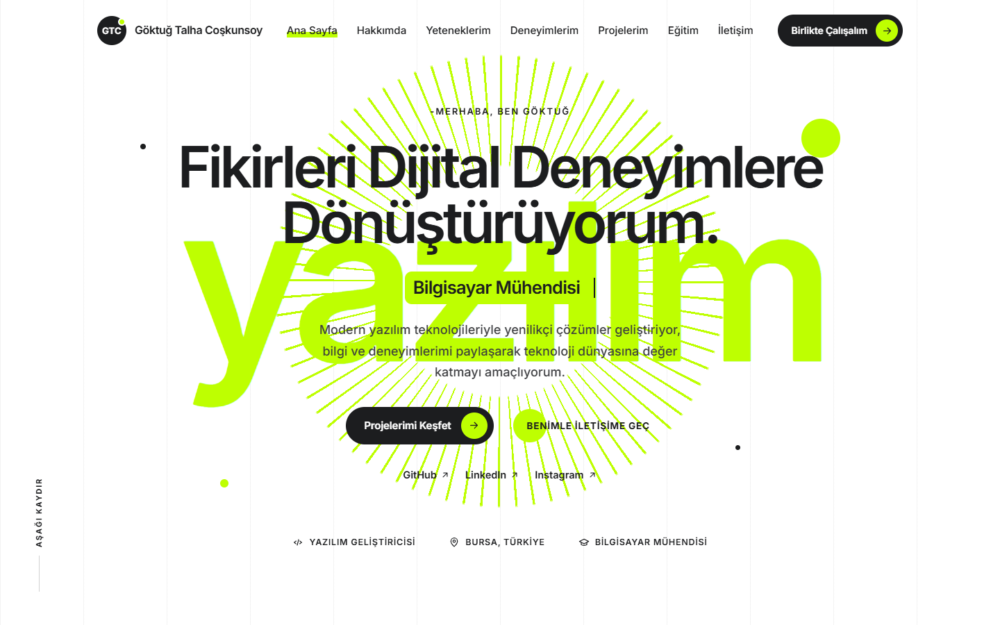</a>
  <br><sub><b>Ana Sayfa</b>: Hero alanı, daktilo efektiyle dönen unvanlar ve sosyal bağlantılar</sub>
</p>

<table>
  <tr>
    <td width="50%" align="center">
      <a href="docs/screenshots/02-hakkimda.png">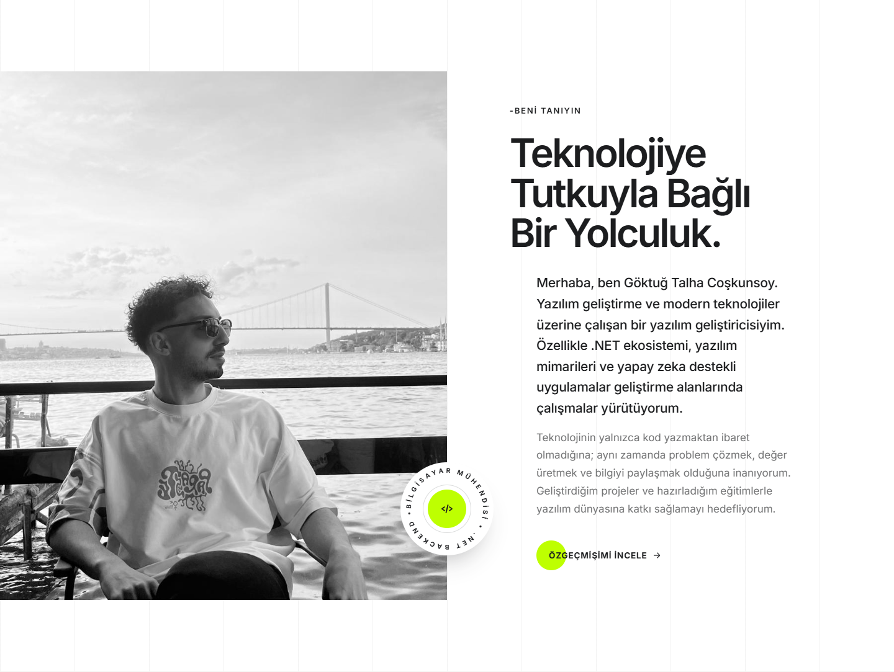</a>
      <sub><b>Hakkımda</b>: Fotoğraf, tanıtım metni ve CV bağlantısı</sub>
    </td>
    <td width="50%" align="center">
      <a href="docs/screenshots/03-yetenekler.png">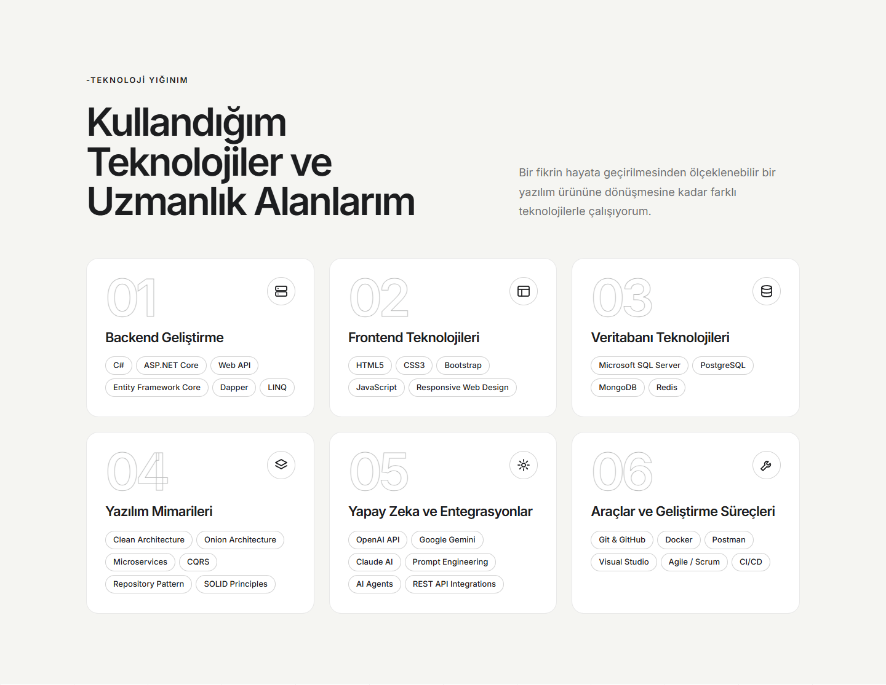</a>
      <sub><b>Yeteneklerim</b>: Sıralı yetenek kartları ve teknoloji etiketleri</sub>
    </td>
  </tr>
  <tr>
    <td width="50%" align="center">
      <a href="docs/screenshots/04-deneyimler.png">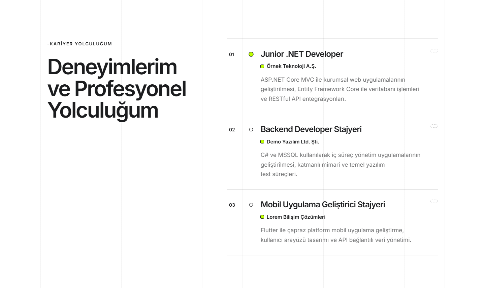</a>
      <sub><b>Deneyimlerim</b>: Zaman çizelgesi görünümü</sub>
    </td>
    <td width="50%" align="center">
      <a href="docs/screenshots/06-egitim.png">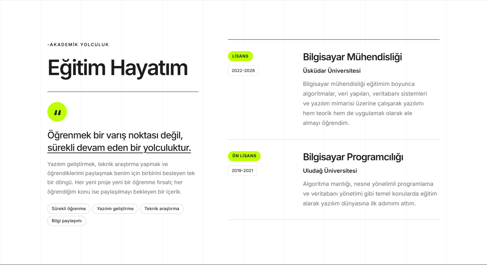</a>
      <sub><b>Eğitim Hayatım</b>: Derece, okul ve yıl bilgileri</sub>
    </td>
  </tr>
  <tr>
    <td width="50%" align="center">
      <a href="docs/screenshots/05-projeler.png">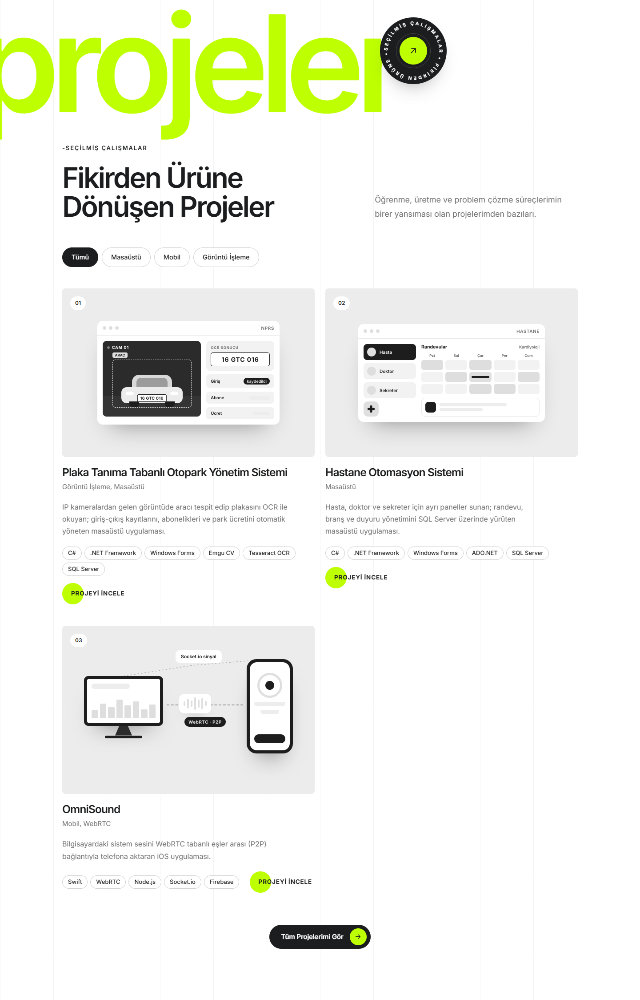</a>
      <sub><b>Projelerim</b>: Kategoriye göre filtrelenebilen proje kartları</sub>
    </td>
    <td width="50%" align="center">
      <a href="docs/screenshots/08-iletisim.png">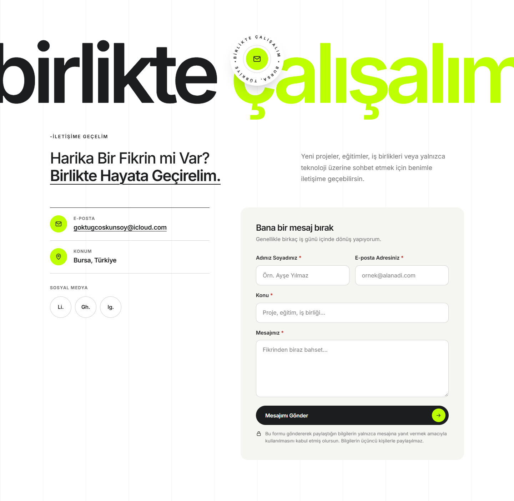</a>
      <sub><b>İletişim</b>: İletişim bilgileri ve mesaj formu</sub>
    </td>
  </tr>
  <tr>
    <td colspan="2" align="center">
      <a href="docs/screenshots/07-felsefe.png">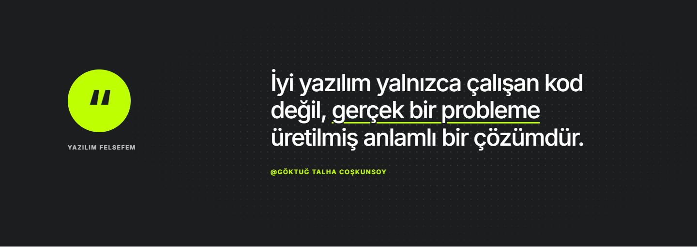</a>
      <sub><b>Yazılım Felsefem</b>: Alıntı bölümü</sub>
    </td>
  </tr>
</table>

### 🛠️ Yönetim Paneli

<table>
  <tr>
    <td width="50%" align="center">
      <a href="docs/screenshots/09-admin-deneyim-listesi.png">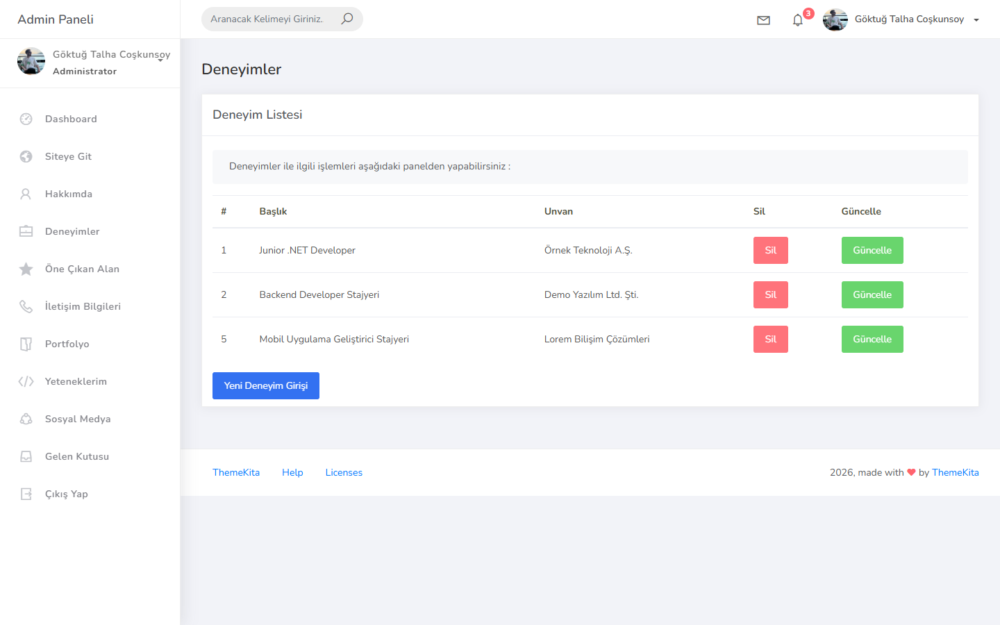</a>
      <sub><b>Deneyim Listesi</b>: Kayıtları listeleme, silme ve güncelleme</sub>
    </td>
    <td width="50%" align="center">
      <a href="docs/screenshots/10-admin-deneyim-ekle.png">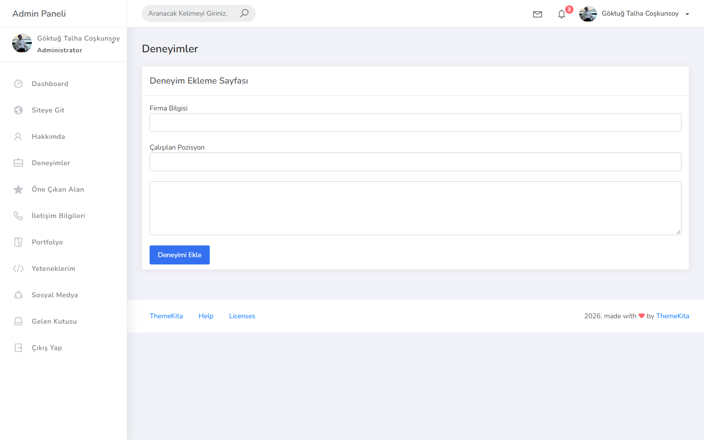</a>
      <sub><b>Deneyim Ekleme</b>: Yeni deneyim formu</sub>
    </td>
  </tr>
  <tr>
    <td width="50%" align="center">
      <a href="docs/screenshots/11-admin-deneyim-guncelle.png">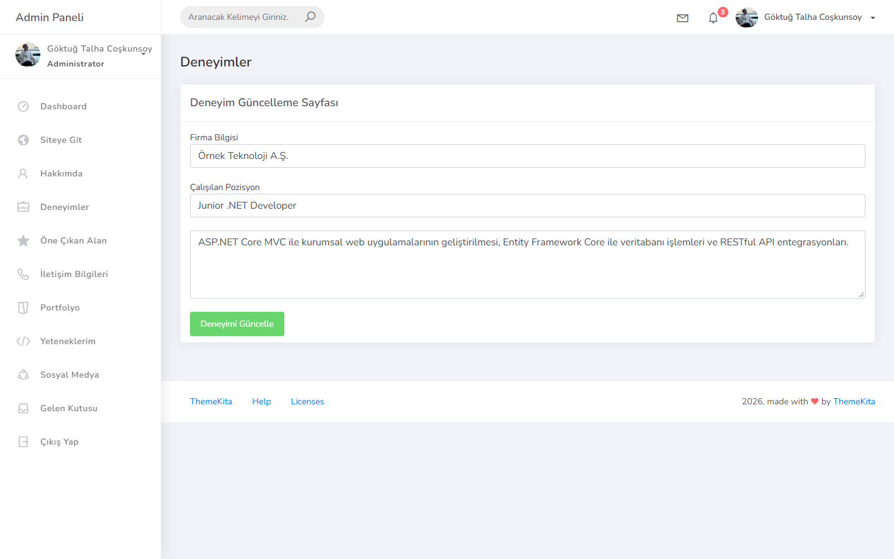</a>
      <sub><b>Deneyim Güncelleme</b>: Mevcut kaydın düzenlenmesi</sub>
    </td>
    <td width="50%" align="center">
      <a href="docs/screenshots/12-admin-gelen-kutusu.png">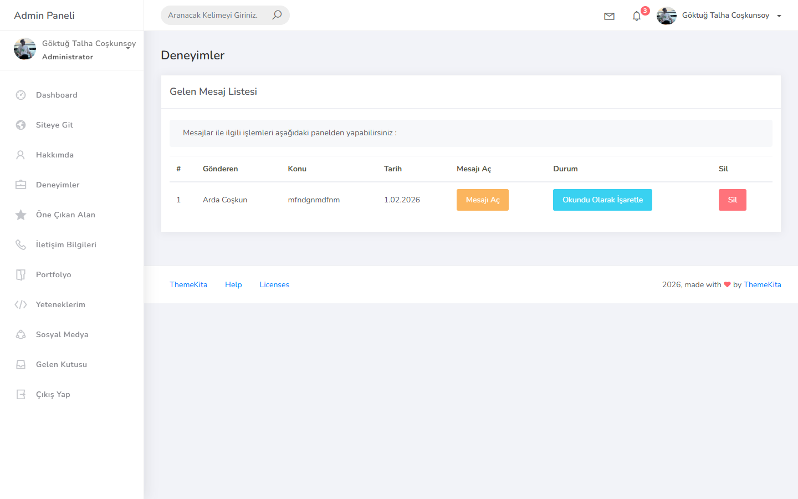</a>
      <sub><b>Gelen Kutusu</b>: Okundu / okunmadı durumu ve silme</sub>
    </td>
  </tr>
  <tr>
    <td width="50%" align="center">
      <a href="docs/screenshots/13-admin-mesaj-detay.png">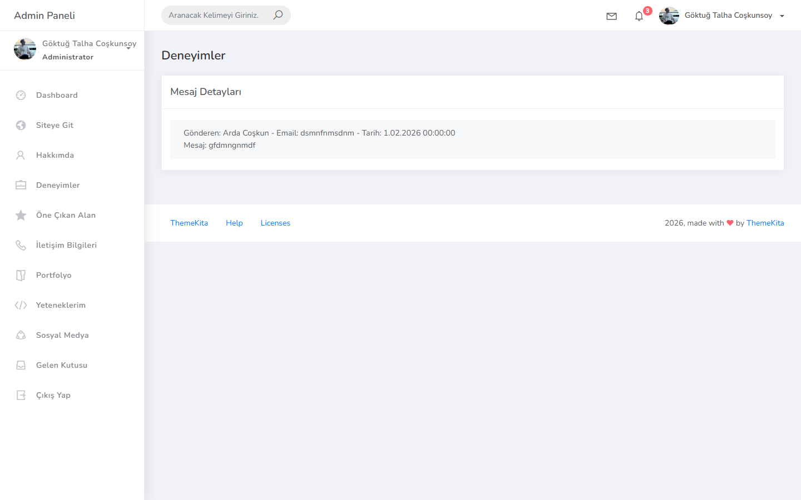</a>
      <sub><b>Mesaj Detayı</b>: Gönderen, e-posta, tarih ve mesaj içeriği</sub>
    </td>
    <td width="50%"></td>
  </tr>
</table>

---

## 📖 Proje Hakkında

**MyPortfolio**, bir yazılım geliştiricinin kendini, yeteneklerini, deneyimlerini ve projelerini tanıttığı kişisel bir web sitesidir. Sayfadaki içerikler koda gömülü değildir; **Entity Framework Core** aracılığıyla **SQL Server** veritabanından okunur. Böylece içerik değiştiğinde HTML'e dokunmadan yalnızca veritabanını güncellemek yeterlidir.

Proje iki ana parçadan oluşur:

| Parça | Adres | Açıklama |
|---|---|---|
| **Portfolyo Sitesi** | `/Default/Index` | Ziyaretçilerin gördüğü, bölümleri ViewComponent'lerle oluşturulan tek sayfalık site |
| **Yönetim Paneli** | `/Experience/ExperienceList`, `/Message/Inbox` | Ready Bootstrap Dashboard temasıyla hazırlanmış, içerik ve mesaj yönetimi ekranları |

---

## ✨ Özellikler

### Portfolyo Sitesi
- **Hero alanı:** Veritabanından gelen karşılama metni, başlık ve açıklama; daktilo efektiyle dönen unvanlar
- **Hakkımda:** Profil fotoğrafı, tanıtım yazısı ve indirilebilir CV bağlantısı
- **Yeteneklerim:** `SkillOrder` alanına göre sıralanan kartlar ve her kartın teknoloji etiketleri
- **Deneyimlerim:** Pozisyon, şirket ve açıklamadan oluşan zaman çizelgesi
- **Projelerim:** Görsel, kategori, açıklama ve teknoloji etiketleri; *Masaüstü / Mobil / Görüntü İşleme* filtreleri
- **Eğitim Hayatım:** Derece, bölüm, üniversite ve yıl bilgileri
- **İletişim:** E-posta, konum, sosyal medya bağlantıları ve istemci taraflı doğrulamalı mesaj formu
- **Responsive tasarım:** Mobil menü, kaydırırken beliren animasyonlar ve aktif bölümü takip eden menü
- **Erişilebilirlik:** ARIA etiketleri ve `prefers-reduced-motion` desteği

---

## 🧩 Mimari

Portfolyo sayfası ([Views/Default/Index.cshtml](MyPortfolio/Views/Default/Index.cshtml)) tek bir büyük view yerine, her bölümü kendi verisini çeken **ViewComponent**'lerden oluşur:

```
Default/Index
├── _HeadComponentPartial          meta etiketleri, fontlar, CSS
├── _NavbarComponentPartial        üst menü + mobil menü
├── _FeatureComponentPartial       → Features
├── _AboutComponentPartial         → Abouts
├── _SkillComponentPartial         → Skills + SkillItems
├── _ExperienceComponentPartial    → Experiences
├── _ProjectsComponentPartial      → Projects + ProjectItems
├── _EducationComponentPartial     → Educations
├── _PhilosophyComponentPartial    statik alıntı bölümü
├── _ContactComponentPartial       iletişim bilgileri + form
└── _FooterComponentPartial        alt bilgi + "yukarı dön"
```

Yönetim panelinin ortak şablonu ([Views/Layout/Index.cshtml](MyPortfolio/Views/Layout/Index.cshtml)) da aynı yaklaşımla `_LayoutHead`, `_LayoutNavbar`, `_LayoutSidebar` ve `_LayoutScript` bileşenlerinden oluşur; panel sayfaları bu şablonu `Layout` olarak kullanır.

---

## 🧰 Teknolojiler

| Katman | Teknoloji |
|---|---|
| Backend | C#, ASP.NET Core MVC (.NET 10) |
| Veri Erişimi | Entity Framework Core 10 (Code First + Migrations) |
| Veritabanı | Microsoft SQL Server Express |
| Arayüz | Razor Views, ViewComponents, HTML5, CSS3, Vanilla JavaScript |

---

## 📋 Gereksinimler

- [.NET 10 SDK](https://dotnet.microsoft.com/download)
- SQL Server (Express sürümü yeterli)
- Entity Framework Core CLI aracı:

```bash
dotnet tool install --global dotnet-ef
```

> [!IMPORTANT]
> Veritabanı bağlantı dizesi şu an [Context/PortfolioContext.cs](MyPortfolio/Context/PortfolioContext.cs) dosyasında sabit olarak `Server=.\SQLEXPRESS` şeklinde tanımlıdır. Farklı bir SQL Server örneği kullanıyorsanız çalıştırmadan önce `Server` değerini kendi örneğinizle değiştirin (örn. `localhost` veya `(localdb)\MSSQLLocalDB`).

---

## 🚀 Kurulum ve Çalıştırma

```bash
git clone https://github.com/goktugcoskunsoyy/MyPortfolio.git
cd MyPortfolio/MyPortfolio
dotnet restore
dotnet ef database update
dotnet run
```

Geliştirme sırasında değişiklikleri anında görmek için `dotnet watch` kullanabilirsiniz.

---

## 📁 Proje Yapısı

```
MyPortfolio/
├── docs/screenshots/                   README ekran görüntüleri
├── MyPortfolio.slnx                    Çözüm dosyası
└── MyPortfolio/
    ├── Context/                        PortfolioContext (EF Core DbContext)
    ├── Controllers/                    Default, Experience, Message, Layout
    ├── Entities/                       12 varlık sınıfı
    ├── Migrations/                     EF Core migration dosyaları
    ├── ViewComponents/                 Portfolyo bölümleri
    │   └── LayoutViewComponents/       Admin panel parçaları
    ├── Views/
    │   ├── Default/                    Portfolyo ana sayfası
    │   ├── Layout/                     Admin panel ortak şablonu
    │   ├── Experience/                 Deneyim listeleme / ekleme / güncelleme
    │   ├── Message/                    Gelen kutusu ve mesaj detayı
    │   └── Shared/Components/          ViewComponent görünümleri
    └── wwwroot/
        ├── MyPortfolioTheme/           Portfolyo teması (CSS, JS, görseller, CV)
        └── Ready-Bootstrap-Dashboard-master/   Admin panel teması
```

---

## ⚠️ Not

Bu proje öğrenme ve geliştirme amaçlı hazırlanmıştır. Yönetim paneli şu an **kimlik doğrulama olmadan** erişilebilir durumdadır; projeyi herkese açık bir sunucuya taşımadan önce panel sayfalarını yetkilendirme ile korumanız ve veritabanı bağlantı bilgilerini kaynak koddan çıkarmanız önerilir.

---

<div align="center">

**Göktuğ Talha Coşkunsoy**

[](https://github.com/goktugcoskunsoyy)
[](https://www.linkedin.com/in/goktugtalha/)

</div>
